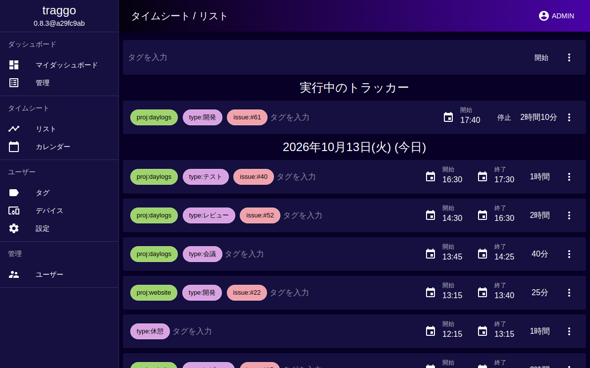
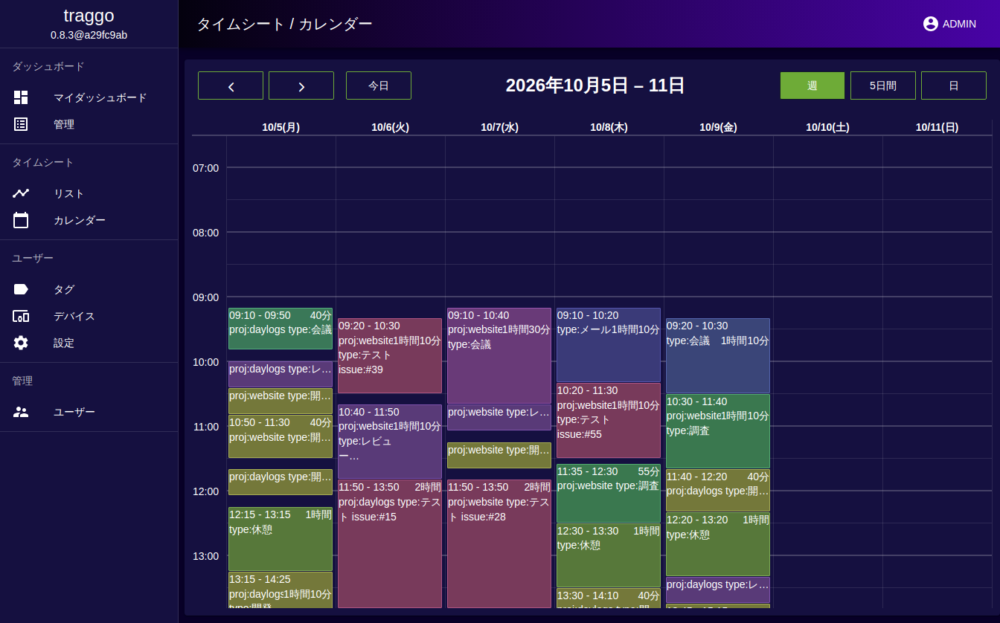
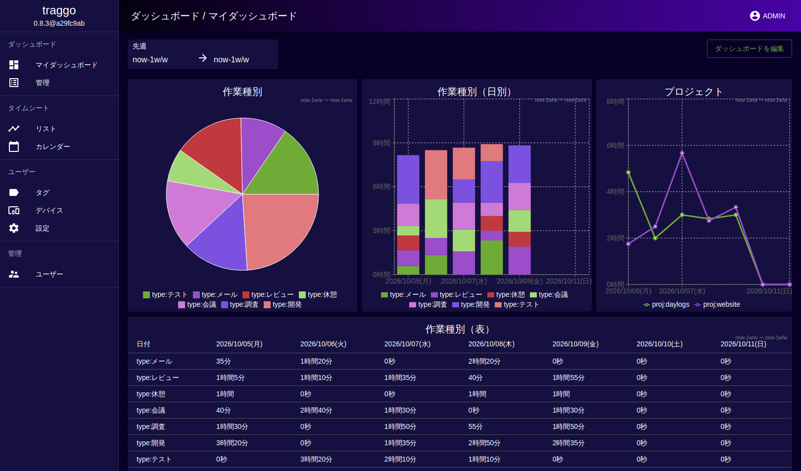

<h1 align="center">DayLogs</h1>
<p align="center"><i>タグベースの社内向け時間記録ツール</i></p>

Based on https://github.com/traggo/server, with custom modifications.

DayLogs ではタスクを作らず、[タグ](https://traggo.net/terminology/#tag)を付けた[時間記録](https://traggo.net/terminology/#timespan)だけで作業を管理します。
例えば案件ごとに `proj` タグ、作業の種類ごとに `type` タグ（`開発`、`レビュー`、`会議` など）を付けておけば、
ダッシュボードで「どの案件・どの作業にどれだけ時間を使ったか」を集計できます。タグの付け方は自由です。

データはすべて自前でホストするサーバー上に保存され、第三者に渡ることはありません。

## 機能

* タグ付きの時間記録（タイマーの開始・停止、手動入力）
* リスト表示とカレンダー表示
* グラフや表を自由に配置できるダッシュボード
* シンプルなユーザー管理

## traggo からの主な変更点

* UI をすべて日本語化
* 日付表示に日本語ロケールを追加し、デフォルトに設定
* First Gaming のロゴカラーをもとにしたテーマを追加し、デフォルトに設定

---

<a href="./.github/daylogs_list.png">
    
</a>
<a href=".github/daylogs_calendar.png">
    
</a>
<a href=".github/daylogs_dashboard.png">
    
</a>

## 起動方法

```bash
docker compose up --build -d
```

http://localhost:3030 を開き、初期ユーザー `admin` / `admin` でログインします。
初回ログイン後、パスワードは必ず変更してください。データ（SQLite）は `.traggodata/` に保存されます。

設定は環境変数 `TRAGGO_*` で変更できます。項目は [.env.sample](.env.sample) と
traggo の [Configuration](https://traggo.net/config/) を参照してください。

## 開発

Go、Node.js、yarn が必要です。手順の詳細は traggo の [Setup Dev Environment](https://traggo.net/dev/setup/) を参照してください。

```bash
make download-tools install generate   # ツール・依存関係の導入とコード生成
make build-bin-local                   # UI をビルドしてバイナリに埋め込む
make lint test
```
